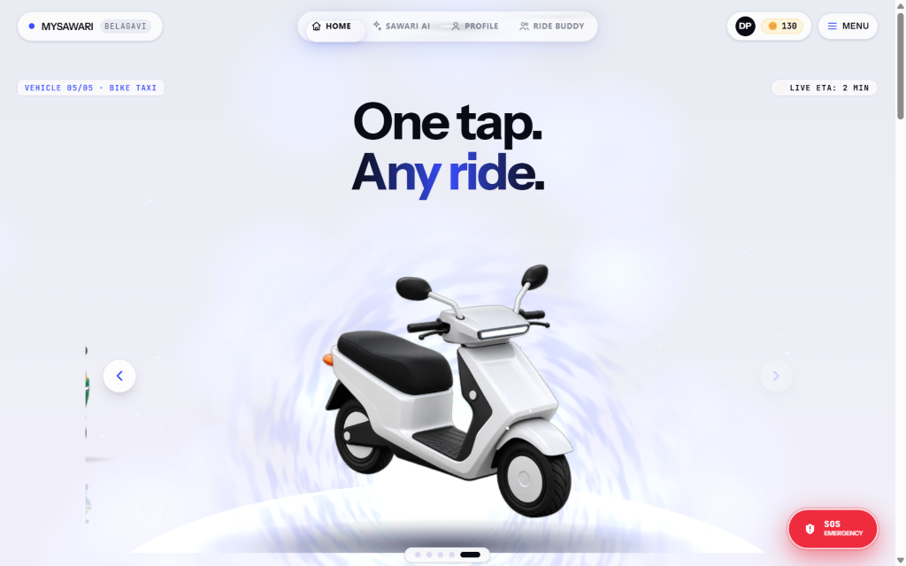
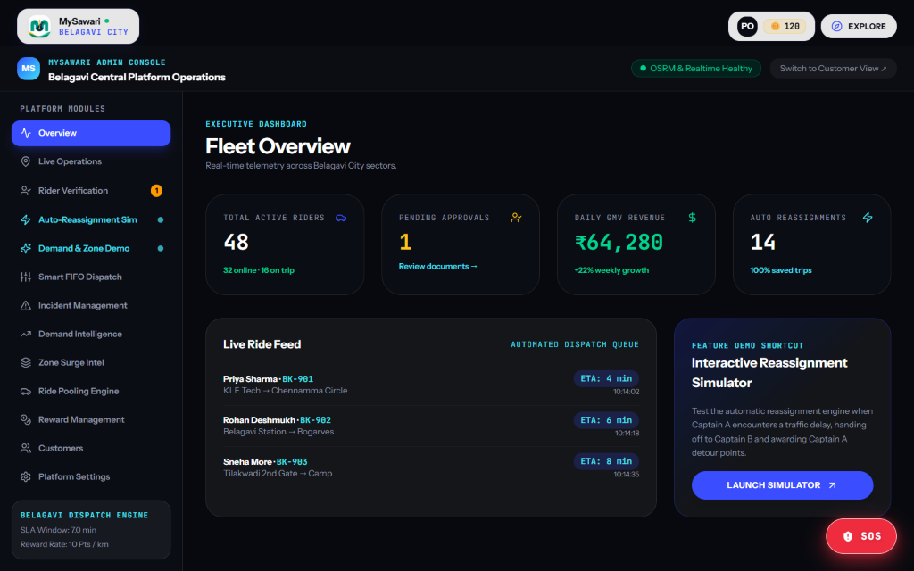
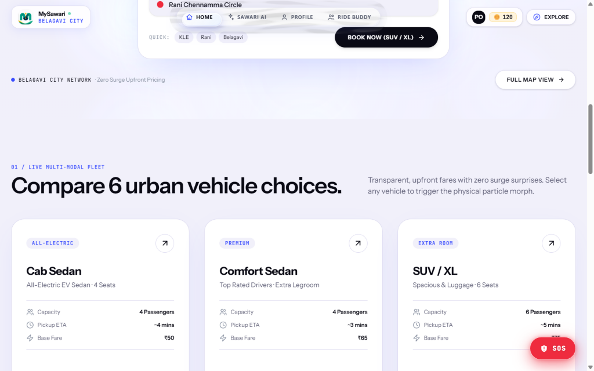
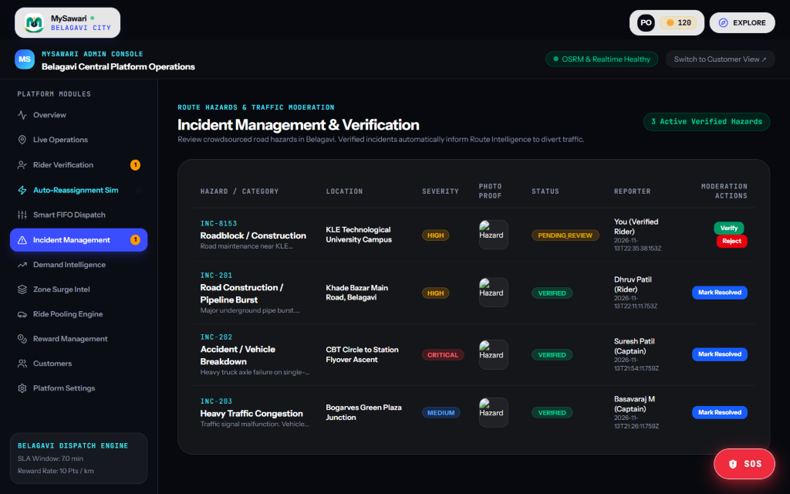
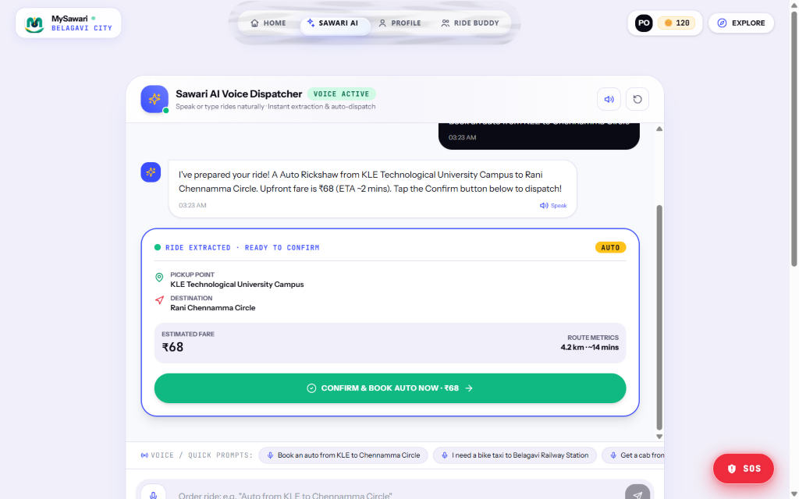

<div align="center">


# MySawari · AI-Powered Intelligent Mobility Ecosystem
### Next-Gen Urban Transit, Smart Dispatch, Ride Pooling & Safety Network for Belagavi City

[](https://vitejs.dev/)
[](https://reactjs.org/)
[](https://threejs.org/)
[](https://nodejs.org/)
[](https://expressjs.com/)
[](https://supabase.com/)
[](https://nodejs.org/api/test.html)

<p align="center">
  <b>One Tap. Any Ride.</b><br>
  Hyper-local Belagavi auto, cab, bike, and multi-passenger ride booking engineered with real-time 3D vehicle physics, live OSRM routing, real SMS/WhatsApp emergency alerts, and predictive demand intelligence.
</p>

</div>

---

## 📸 Visual Showcase

### 1. Interactive 3D Vehicle Morphing Stage & Liquid Water Navbar
Experience seamless real-time vehicle switching between **Bike, Auto, Cab, Comfort, and XL** with interactive physics, realistic lighting, and our custom WebGL liquid caustics navbar.
<div align="center">
  
</div>

<br>

### 2. Predictive Demand Forecasting & Belagavi Zone Intelligence
Machine learning powered demand prediction using **Gradient Boosted Decision Stumps (`gb-stumps-hour-zone-v1`)**. Real-time GIS heatmap, 24-hr hourly comparative trends, 7-day volume forecasting, and automated driver repositioning advisories.
<div align="center">
  
</div>

<br>

### 3. Real SOS Emergency Notification System (SMS & WhatsApp via MSG91)
Two dedicated emergency communication channels. Live tested with MSG91 SMS gateway delivering real-time Google Maps coordinates, ride information, and vehicle numbers to verified emergency contacts.
<div align="center">
  
</div>

<br>

### 4. Smart Route Comparison & RoadPulse Crowdsourced Hazards
Real-time routing via Open Source Routing Machine (OSRM). Compare fastest and shortest road paths, detect traffic detours, and report live accidents, pipeline works, and waterlogging.
<div align="center">
  
</div>

<br>

### 5. Sawari AI Voice Mobility Assistant
Bilingual interactive voice & speech assistance for effortless route inquiries, instant vehicle bookings, and landmark queries across Belagavi.
<div align="center">
  
</div>

---

## 🌟 Core Feature Matrix

### 🚗 Passenger Experience
- **Interactive 3D Carousel**: Physically morphing 3D vehicles rendered in Three.js with orbit controls, realistic metallic shaders, and smooth camera transitions.
- **Instant Fares**: Dynamic base fare + distance + real-time demand multiplier calculation.
- **4-Digit Ride OTP**: Cryptographic verification code generated on booking. Drivers cannot initiate trips without verified passenger input.
- **Ride Buddy (Smart Pooling)**: Intelligent passenger matching along identical transit corridors with `<20%` detour cap and 30–50% cost savings.
- **Language Localization**: Complete Kannada (ಕನ್ನಡ), Hindi (हिंदी), and English UI support.

### 🛡️ Real Emergency Safety System
- **Dual-Channel Only**: Strictly sends alerts via **SMS** and **WhatsApp**. No email clutter or fake audio calls.
- **E.164 Number Normalization**: Clean normalization for Indian and international numbers.
- **5-Contact Safety Vault**: Add up to 5 trusted emergency contacts with OTP verification.
- **One-Touch SOS**: Captures precise GPS coordinates, generates clickable Google Maps link, and dispatches incident dossiers to all verified contacts in seconds.
- **Idempotent Dispatch**: 60-second duplicate suppression window prevents accidental panic taps.

### 🛵 Captain (Driver) Portal
- **Streamlined 3-Step Onboarding**: Driving license, RC book, and vehicle verification.
- **Online/Offline Dispatch Toggle**: Instant availability switching for ride queues.
- **OTP Start Trip Gating**: Built-in verification keypad for 4-digit passenger OTP.
- **Reassignment Bonus Ledger**: Automated wallet credit compensating drivers for traffic congestion detours and long pickups.
- **Wallet Points Conversion**: 1-click reward point redemption into driver bank balances.

### 🏛️ Central Platform Operations (Admin Console)
- **Live Fleet Dispatch**: Real-time driver tracking, active rides monitor, and queue statuses.
- **Predictive Demand Intelligence**: 24-hour comparative charts, GIS demand heatmaps, and surplus/shortage driver rebalancing recommendations.
- **RoadPulse Traffic Console**: Review and verify crowdsourced road closures, pipeline repairs, and traffic hazard reports.
- **Emergency SOS Command Center**: Real-time incident alerts, GPS coordinates, vehicle dossiers, and incident acknowledgment/resolution workflows.
- **Reassignment Stepper Sandbox**: Interactive 5-step simulator demonstrating automatic fallback reassignment when drivers reject requests.

---

## 🏗️ Architecture & Technology Stack

```
                              ┌──────────────────────────────────────────────┐
                              │            MySawari Client Web App           │
                              │       React 18 · Vite 5 · Tailwind CSS       │
                              │    Three.js 3D Morph · Liquid WebGL Shaders   │
                              └──────────────────────┬───────────────────────┘
                                                     │ HTTPS / REST / WSS
                                                     ▼
                              ┌──────────────────────────────────────────────┐
                              │            MySawari Core Backend             │
                              │         Node.js 22+ · Express 5 REST         │
                              │    31 Automated Unit Tests · Rate Limiting   │
                              └───────┬──────────────┬──────────────┬────────┘
                                      │              │              │
                   ┌──────────────────┴──┐    ┌──────┴─────────┐    └───┬──────────────────┐
                   ▼                     ▼    ▼                ▼        ▼                  ▼
          ┌─────────────────┐  ┌───────────┐  ┌─────────────┐  ┌───────────────┐  ┌────────────────┐
          │ Supabase (PG)   │  │   OSRM    │  │ MSG91 SMS   │  │  Meta / MSG91 │  │ Razorpay (INR) │
          │ Auth, RLS, DB   │  │ Routing   │  │ OTP & SOS   │  │   WhatsApp    │  │ Orders & Pay   │
          └─────────────────┘  └───────────┘  └─────────────┘  └───────────────┘  └────────────────┘
```

---

## ⚡ Quick Start & Local Setup

### 1. Prerequisites
- **Node.js**: `v20.0.0` or higher (`v22+` recommended)
- **npm**: `v9.0.0` or higher
- **Git**

### 2. Clone the Repository
```bash
git clone https://github.com/dhruva77vernekar-hub/MySawari.git
cd MySawari
```

### 3. Backend Setup
```bash
cd backend

# Install dependencies
npm install

# Configure environment variables
cp .env.example .env

# Verify database migrations and code syntax
npm run check
npm run db:check

# Run backend unit test suite (31 tests)
npm test

# Start backend server (Port 4000)
npm run dev
```

### 4. Frontend Setup
```bash
cd ../frontend

# Install dependencies
npm install

# Start Vite development server (Port 5173)
npm run dev
```

Open your browser and navigate to:
- **Customer Web App**: [http://localhost:5173/](http://localhost:5173/)
- **Captain (Driver) Portal**: [http://localhost:5173/rider/dashboard](http://localhost:5173/rider/dashboard)
- **Central Admin Console**: [http://localhost:5173/admin](http://localhost:5173/admin)
- **Backend Health Check**: [http://localhost:4000/api/health](http://localhost:4000/api/health)

---

## 🧪 Automated Testing & Verification

The backend includes a comprehensive, zero-dependency test suite running on Node.js native test runner:

```bash
cd backend
npm test
```

### Test Coverage Highlights:
- **Fare Matrix**: Base fare retention, capped surge multipliers, zero-distance edge cases.
- **Gradient Boost Forecasting**: Training holdout MAE, heuristic fallbacks, non-negative prediction clamping.
- **Geographic Calculations**: Haversine distance, Belagavi boundary polygon raycasting.
- **Ride Pooling Optimizer**: Strict pickup-before-drop ordering, `<20%` detour constraints, capacity limits.
- **Safety & SOS Gateway**: E.164 phone normalization, 5-contact enforcement, duplicate prevention, 6-digit OTP verification.
- **Razorpay Payments**: Paise currency unit conversion, cryptographic HMAC SHA256 signature verification.

---

## 📄 Database Migrations

The database schema is organized into versioned, idempotent PostgreSQL migrations located in `backend/supabase/migrations/`:
1. `001_phase1_foundation.sql` — User profiles, roles, and core authentication structures.
2. `002_full_platform.sql` — Vehicle types, rides, captains, and realtime location coordinates.
3. `003_dispatch_security_forecasting.sql` — Predictive zone demand tables, surge rules, and RLS policies.
4. `004_pool_dispatch_and_model_forecasting.sql` — Multi-passenger pool dispatch and forecasting model coefficients.
5. `20261113_create_payments.sql` — Payment transactions, Razorpay order IDs, and webhook logs.
6. `20261114_create_emergency_sos.sql` — Emergency contacts, SOS incident registry, and delivery logs.

---

## 🔐 Environment Configuration

Create a `.env` file in `backend/` with the following keys (see `backend/.env.example`):

```env
PORT=4000
NODE_ENV=development

# Supabase PostgreSQL
SUPABASE_URL=https://your-project.supabase.co
SUPABASE_ANON_KEY=your-anon-key
SUPABASE_SERVICE_ROLE_KEY=your-service-role-key

# MSG91 SMS & WhatsApp Emergency Gateway
SOS_SMS_AUTH_KEY=your-msg91-auth-key
SOS_SMS_SENDER_ID=SAWARI
WHATSAPP_ENABLED=true

# Razorpay Payments
RAZORPAY_KEY_ID=your-razorpay-key
RAZORPAY_KEY_SECRET=your-razorpay-secret

# OSRM Routing Engine
OSRM_BASE_URL=https://router.project-osrm.org
```

---

## 👥 Contributors & Acknowledgments
- **Project Lead & Architecture**: Dhruv Vernekar ([@dhruva77vernekar-hub](https://github.com/dhruva77vernekar-hub))
- **Platform**: Belagavi Smart Urban Mobility Initiative
- **Special Thanks**: Belagavi Auto Driver Unions, KLE Tech Mobility Labs, OpenStreetMap contributors.

---

<div align="center">
  <sub>Built with ❤️ for Belagavi City · MySawari Mobility Platform</sub>
</div>
